<p align="center">
  
</p>

# forked

**Git for agent state.**

Your agent crashed after charging the card. You retried it. **Nobody got
charged twice**, because the effect log replayed the stored result
instead of re-running the charge.

forked lets AI agents fork, rewind and replay their structured state
(messages, memory, plans, tool results), with a side-effect log that keeps
emails, payments and API calls effectively-once across retries and rewinds
(recorded idempotency keys replay their stored result; strict when a
session has a single writer at a time, as in forked cloud).

- **A fork is one ref write**: 1,000 branches in ~1.4 ms in memory, ~276 ms
  on durable SQLite, zero bytes of state copied either way. Reproduce it:
  `cargo run --release -p forked-sqlite --example bench`
- **Rewind is byte-exact**, and the abandoned history stays anchored.
- **Diffs skip identical subtrees by hash**, so work scales with the
  change, not the state size.

forked versions the agent's own structured state, not whole sandboxes: no
file or process snapshots, just a persistent key→JSON map with git-like
branches, commits and diffs, plus the effect log.

Use it three ways. Same API in all three, switch via `baseUrl`:

1. **Rust library**, embed `forked-core` with any storage adapter.
2. **Self-hosted server**, one binary + SQLite, or Docker.
3. **forked cloud**, managed on Cloudflare, with a console that draws
   every session's branch tree.

## Quick start (self-hosted)

```sh
cargo run -p forked-server -- --db forked.db
# or: docker build -f forked-server/Dockerfile -t forked-server . && docker run -p 8080:8080 forked-server
```

```ts
import { ForkedClient } from "@forked-run/client";

const forked = new ForkedClient({ baseUrl: "http://localhost:8080" });
const session = await forked.createSession();
const main = session.branch();

await main.put({ plan: ["draft", "review", "send"], step: 1 });

const alt = await main.fork("alternative");   // O(1), nothing is copied
await alt.put({ step: 2 });

const history = await main.log();
await main.checkout(history[1].hash);          // rewind, byte-exact

await session.recordEffect({                   // replays stored result on retry
  key: "send-email:42",
  kind: "email.send",
  result: { messageId: "abc" },
});
```

Using LangGraph? `@forked-run/langgraph` is a drop-in checkpointer where time
travel becomes a real branch rewind, see
[clients/langgraph](clients/langgraph/README.md).

## How it works

- State is a **persistent, structurally shared tree** (a HAMT): commits
  rewrite only the touched path, forks write a single ref, diffs skip
  identical subtrees by hash.
- Everything is **content-addressed** (SHA-256, deterministic CBOR): the
  same state always has the same hash, on every backend.
- Storage needs only **blob put/get + one compare-and-swap on a ref**, so
  backends range from an in-memory map to SQLite and Cloudflare Durable
  Objects.
- **Effect records live inside commits**, so "commit + record effects" is
  atomic under that single CAS on every backend. Rewinds never undo an
  effect: replaying a recorded idempotency key returns the stored result.

Specs: [docs/FORMAT.md](docs/FORMAT.md) (on-disk format),
[docs/API.md](docs/API.md) (HTTP API).

## Repository layout

| Path | What it is |
|---|---|
| `forked-core` | engine: persistent map, commits, fork/checkout, log, diff, effects, `Storage` trait. Compiles for `wasm32-unknown-unknown`. |
| `forked-memory` | in-memory adapter (tests, local dev) |
| `forked-sqlite` | SQLite adapter (bundled, zero system deps) |
| `forked-api` | shared HTTP contract: DTOs + one dispatcher used by *both* servers |
| `forked-server` | self-hostable axum server + Dockerfile |
| `clients/ts` | `@forked-run/client` TypeScript SDK |
| `clients/langgraph` | `@forked-run/langgraph` LangGraph checkpointer |
| `clients/mcp` | `@forked-run/mcp` MCP server, gives any MCP agent (Claude Code, Cursor, …) checkpoint/rewind/effect tools |
| `examples` | runnable use-case walkthroughs: safe retry (effectively-once effects), time-travel debugging, best-of-N exploration |

Everything a single developer needs is and stays open source (Apache-2.0).
forked cloud runs these same crates, its account/billing/console layer
lives in a private repo, but it speaks the exact `forked-api` contract
above, so nothing it does is behaviorally special.

## Development

```sh
# Rust: engine, adapters, server
cargo test --workspace
cargo clippy --workspace --all-targets -- -D warnings
cargo build -p forked-core --target wasm32-unknown-unknown

# TypeScript SDK + checkpointer
cd clients/ts && npm install && npm run check && npm run build
cd clients/langgraph && npm install && npm run check

# End-to-end smoke test + use-case examples
cargo run -p forked-server -- --db memory --addr 127.0.0.1:8099 &
node clients/langgraph/examples/smoke.mjs
cd examples && npm install && FORKED_URL=http://127.0.0.1:8099 npm run all
```

`forked-core` must keep building for `wasm32-unknown-unknown`: no threads,
no OS I/O, no tokio, no `Send` bounds on storage futures, no panics in
normal paths, forked cloud runs it inside Cloudflare Durable Objects.

## License

Apache-2.0
